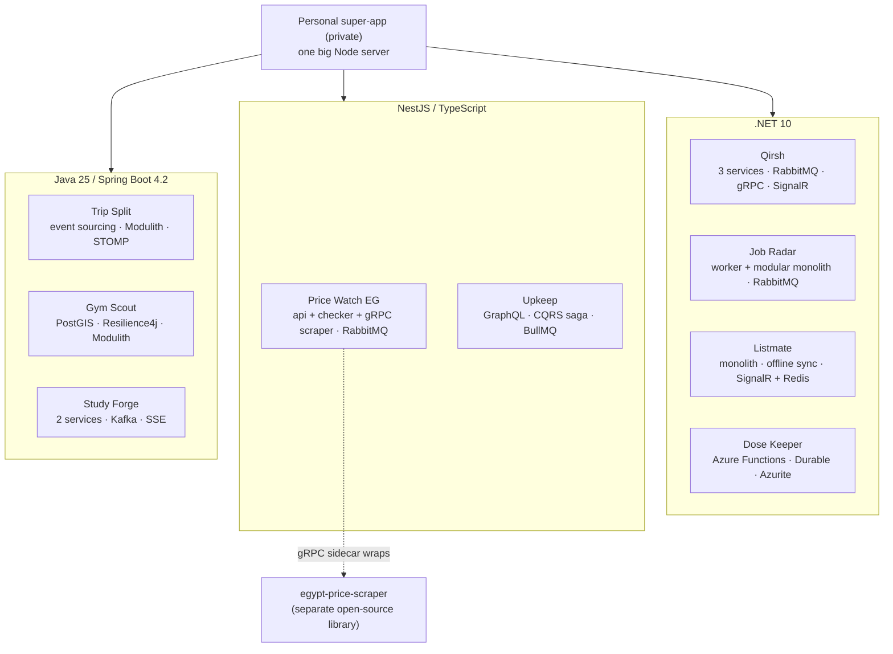

# Systems Portfolio

**Nine small, focused open-source apps carved out of one personal super-app, each built to show a different
distributed-systems or clean-architecture idea, in .NET, NestJS and Java.**

"Lingo" is a personal super-app I use every day: money, jobs, lists, prices, trips, car and home upkeep,
medication, the gym, learning. Over time it became one big server doing everything. These repositories take one corner of it
each and rebuild it from scratch as a standalone product with a fresh history and invented data only. The point is
not the features; it is to have small, honest codebases where a pattern such as a transactional outbox, event
sourcing, offline sync or a Durable Functions orchestration is the core of the design, is tested against real
infrastructure with Testcontainers, and runs on any laptop with one `docker compose up`.

This repository holds no application code. It is the map: what each app is, which patterns it really implements
(checked in the code, not copied from a wish list), how to run any of them, and what is not production-ready yet.

- [docs/patterns.md](docs/patterns.md): each pattern in a few lines, linked to the exact file that implements it.
- [docs/interview-guide.md](docs/interview-guide.md): per app, a 60-second pitch, the bugs and trade-offs found
  while building it, likely questions with short answers, and what I would do next.

## The apps

| App | One-line pitch | Stack | Key patterns | Link | CI |
|---|---|---|---|---|---|
| **Qirsh** | Egyptian bank and wallet SMS become a clean ledger and monthly budgets with live alerts | .NET 10, MassTransit, RabbitMQ / Azure Service Bus, EF Core + Postgres, gRPC, SignalR, React | 3 microservices, transactional outbox + inbox, gRPC queries vs events for facts, schema per service | [ahmedoshelmy/qirsh](https://github.com/ahmedoshelmy/qirsh) | [](https://github.com/ahmedoshelmy/qirsh/actions/workflows/ci.yml) |
| **Job Radar** | Polls public job-board APIs, dedupes across feeds, scores openings with readable reasons, tracks applications | .NET 10, MassTransit + RabbitMQ, EF Core + Postgres, SignalR, Http.Resilience, React | Modular monolith + worker, pub/sub fan-out, outbox + inbox, per-host retry / breaker / rate limit | [ahmedoshelmy/job-radar](https://github.com/ahmedoshelmy/job-radar) | [](https://github.com/ahmedoshelmy/job-radar/actions/workflows/ci.yml) |
| **Listmate** | Shared lists that update live on every phone and keep working offline | .NET 10, ASP.NET Core Identity, SignalR (+ Redis backplane), EF Core + Postgres, React PWA (IndexedDB) | Offline-first sync with idempotent mutations, per-field last-writer-wins, `xmin` optimistic concurrency, scale-out | [ahmedoshelmy/listmate](https://github.com/ahmedoshelmy/listmate) | [](https://github.com/ahmedoshelmy/listmate/actions/workflows/ci.yml) |
| **Price Watch EG** | Watch a product across Egyptian shops, keep its history, get a live toast on a real drop | NestJS, TypeORM + Postgres, RabbitMQ, gRPC sidecar, socket.io, OpenTelemetry, React | Outbox relay, competing consumers vs fan-out, lease-based scheduling (`SKIP LOCKED`), gRPC deadlines + streaming | [ahmedoshelmy/price-watch-eg](https://github.com/ahmedoshelmy/price-watch-eg) | [](https://github.com/ahmedoshelmy/price-watch-eg/actions/workflows/ci.yml) |
| **Trip Split** | Split trip costs: live balances, fewest transfers to settle up, full history with undo and time travel | Java 25, Spring Boot 4.2, Spring Modulith, Postgres, STOMP WebSockets, React | Hand-rolled event sourcing, CQRS projections, ETag / `If-Match` concurrency, Modulith outbox | [ahmedoshelmy/trip-split](https://github.com/ahmedoshelmy/trip-split) | [](https://github.com/ahmedoshelmy/trip-split/actions/workflows/ci.yml) |
| **Upkeep** | Car and home maintenance with reminders that actually fire ("10 000 km or 6 months, whichever first") | NestJS, GraphQL (Apollo, graphql-ws), `@nestjs/cqrs`, BullMQ + Redis, Postgres, React + urql | CQRS + saga, delayed jobs with retry and dead-letter queue, GraphQL subscriptions, query cost limits | [ahmedoshelmy/upkeep](https://github.com/ahmedoshelmy/upkeep) | [](https://github.com/ahmedoshelmy/upkeep/actions/workflows/ci.yml) |
| **Dose Keeper** | Medication schedules with escalating reminders, refill forecasts and adherence (demo only, not medical advice) | .NET 10 Azure Functions (isolated), Durable Functions, Table + Queue Storage, Azurite, React | Eternal orchestration, human-interaction pattern, fan-out / fan-in, poison queue, self-healing timer | [ahmedoshelmy/dose-keeper](https://github.com/ahmedoshelmy/dose-keeper) | [](https://github.com/ahmedoshelmy/dose-keeper/actions/workflows/ci.yml) |
| **Gym Scout** | Find gyms near you or on your commute by real price per visit, then log workouts and records | Java 25, Spring Boot 4.2, Spring Modulith, PostGIS, Resilience4j, Caffeine, React + Leaflet | Geospatial KNN + corridor search, polite outbound calls (rate limit, bulkhead, retry, breaker, fallback), ports and adapters | [ahmedoshelmy/gym-scout](https://github.com/ahmedoshelmy/gym-scout) | [](https://github.com/ahmedoshelmy/gym-scout/actions/workflows/ci.yml) |
| **Study Forge** | Learning roadmaps and spaced repetition, with progress analytics streamed over Kafka | Java 25, Spring Boot 4.2, Spring Kafka (Redpanda), Spring Modulith, Postgres + Flyway, SSE, React | 2 services with database per service, outbox to Kafka, idempotent consumer, retry topics + DLT, JSON Schema contracts | [ahmedoshelmy/study-forge](https://github.com/ahmedoshelmy/study-forge) | [](https://github.com/ahmedoshelmy/study-forge/actions/workflows/ci.yml) |

## Capability matrix

✓ means the repository really does it, in code that runs in its tests or its compose stack. A short word instead
of ✓ means a partial or different take on the pattern; an empty cell means it is not there.

| Pattern | Qirsh | Job Radar | Listmate | Price Watch | Trip Split | Upkeep | Dose Keeper | Gym Scout | Study Forge |
|---|:-:|:-:|:-:|:-:|:-:|:-:|:-:|:-:|:-:|
| Clean Architecture / DDD | ✓ | ✓ | ✓ | ✓ | ✓ | ✓ | ✓ | ✓ | ✓ |
| CQRS (separate write and read paths) | | | | | ✓ | ✓ | | | ✓ read side is its own service |
| Event sourcing | | | | | ✓ | | | | |
| Transactional outbox / inbox | ✓ both | ✓ both | inbox-style log | ✓ outbox | ✓ outbox (Modulith) | | | ✓ outbox (Modulith) | ✓ outbox (Modulith) + dedupe table |
| Pub/sub over a broker | ✓ RabbitMQ / Service Bus | ✓ RabbitMQ / Service Bus | Redis backplane | ✓ RabbitMQ | | Redis pub/sub | Storage queues | | ✓ Kafka (Redpanda) |
| Competing consumers | | | | ✓ | | ✓ | | | consumer group |
| gRPC | ✓ | | | ✓ | | | | | |
| Real-time push | SignalR | SignalR | SignalR | socket.io | STOMP | GraphQL subscriptions | | | SSE |
| Offline sync | | | ✓ | | | | | | |
| Serverless / Durable Functions | | | | | | | ✓ | | |
| Geospatial | | | | | | | | ✓ PostGIS | |
| Resilience (retry / breaker / rate limit) | gRPC deadline + fallback | ✓ | bounded retry on conflict | deadlines, concurrency cap, DLQ | | retry + backoff, DLQ | poison queue, repair timer | ✓ | retry topics + DLT |
| Observability (OpenTelemetry) | ✓ | ✓ | ✓ | ✓ | | | | Micrometer metrics | ✓ |
| Testcontainers | ✓ | ✓ | ✓ | ✓ | ✓ | ✓ | ✓ Azurite | ✓ PostGIS | ✓ Postgres + Redpanda |
| Architecture tests | ✓ | ✓ | ✓ | lint rule | ✓ ArchUnit + Modulith | lint rule | ✓ | ✓ ArchUnit + Modulith | ✓ ArchUnit |
| IaC (Bicep) | ✓ | ✓ | ✓ | | | | ✓ | | |
| CI (GitHub Actions) | ✓ | ✓ | ✓ | ✓ | ✓ | ✓ | ✓ | ✓ | ✓ |

Notes on the less obvious cells:

- **Listmate, inbox-style log**: there is no broker. Each client mutation id is stored in a `processed_mutations`
  table in the same transaction as the change, which is the inbox idea applied to HTTP sync batches.
- **Price Watch and Upkeep, lint rule**: the dependency rule is enforced by `eslint-plugin-boundaries` in the lint
  step rather than by a test project; the build still fails on a layer leak.
- **Upkeep, Redis pub/sub**: BullMQ on Redis carries the jobs; Redis pub/sub relays notifications to every API
  replica for the GraphQL subscription.
- **Dose Keeper, storage queues**: Azure Storage queues with a poison queue, not a pub/sub broker.
- **Study Forge, consumer group**: the insights listeners share one Kafka consumer group and events are keyed by
  learner, so replicas would split partitions; the stack runs one replica and no test scales it out.

## Landscape



Every app runs on its own; they do not call each other. What they share is a set of conventions: Clean
Architecture layers with an enforced dependency rule, ADRs in `docs/adr/`, a `compose.yaml` with health checks
and memory limits, a `scripts/smoke.sh` end-to-end check, invented demo data behind a flag, and a CI workflow that
builds, tests (including Testcontainers) and builds the images.

## How to run any app

Each app needs only Docker (or Podman with the Docker CLI):

```bash
git clone https://github.com/ahmedoshelmy/<app>
cd <app>
cp .env.example .env              # optional; every value has a local default
docker compose up -d --build --wait
./scripts/smoke.sh                # end-to-end check from the command line
docker compose down -v
```

The web port and the demo-data flag differ per app and are in each README. Nothing reaches the internet by
default: job feeds, shop searches, map data and travel times all have offline fakes, and the live sources are a
configuration switch. Several apps can show traces in the .NET Aspire dashboard with
`docker compose --profile obs up -d`.

To build and test from source you need the app's own SDK: .NET 10, Node 22, or JDK 25 (the Java apps use the
Maven wrapper).

## What is not production-ready

These are portfolio projects, built quickly and tested well, but not hardened products. Taken from each README's
own known gaps:

- **No authentication** in Qirsh, Job Radar, Price Watch EG, Trip Split, Upkeep, Dose Keeper, Gym Scout and Study Forge: they
  are single-user tools meant for your own machine or network. Only Listmate has accounts (ASP.NET Core Identity
  bearer tokens).
- **Bicep never deployed.** Qirsh, Job Radar, Listmate and Dose Keeper ship Bicep that CI only compiles. Missing
  pieces are written down: Qirsh's internal gRPC port needs an extra port mapping, images need a registry, and
  Listmate's web upstream must point at the API's internal ingress. Price Watch EG, Trip Split, Upkeep, Gym
  Scout and Study Forge are compose-only.
- **Single-instance limits.** Trip Split uses an in-memory STOMP broker (one API instance); Listmate's presence is
  per replica, and a removed member is evicted live only on the replica that handled the removal.
- **Unbounded or in-process recovery.** Price Watch EG has no outbox retention job and no per-shop circuit
  breaker; Upkeep retries its saga planning in-process, so a crash mid-retry still loses the plan until the sweep
  job catches it.
- **Trusting clocks and inputs.** Trip Split's `asOf` trusts the server clock and exchange rates are typed by hand;
  Qirsh treats two byte-identical SMS (same text and balance) as one.
- **Study Forge's retries can reorder.** Non-blocking retry topics let a retried event be overtaken by a later
  one (accepted and written down in its ADR 0002); FSRS scheduling exists only as an interface.
- **Dose Keeper is a demo**, not a medical device; notifications go to a stub channel.
- **Live data sources** (job boards, Egyptian shops, OpenStreetMap Overpass, the public OSRM server) are free
  community or public endpoints; the apps are polite to them, but none of this is meant for heavy traffic.

## License

[MIT](LICENSE). Each app has its own MIT license in its repository.
